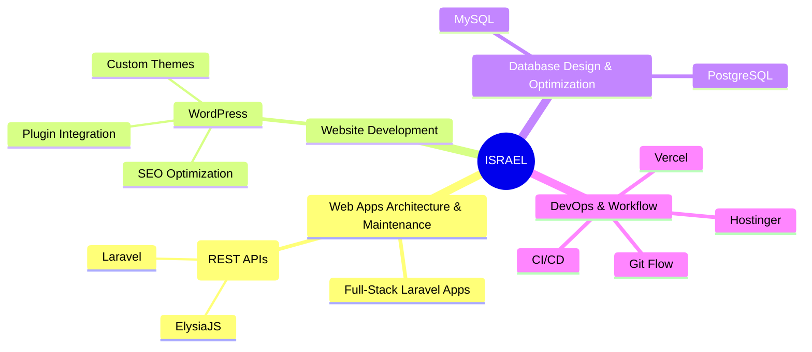

# 👋 Hi, I'm ISRAEL

### Software Engineer | Web Developer – Backend | Laravel, ElysiaJS

### _“In heaven and earth, I alone am the honored one.”_

---

## 🎯 About Me

- 📍 Lomé, Togo 🇹🇬
- 💻 Backend developer, Laravel and ElysiaJS
- 🌱 Currently learning: Next.js, React, Docker
- ☕ Coffee in, code out

---

## 🛠️ Tech Stack & Tools

**Languages**

**Backend / Frameworks**

**Frontend**

**CMS**

**Databases**

**DevOps / Hosting**

-2088FF?style=for-the-badge&logo=githubactions&logoColor=white>)

**Tools / Quality / Security**

**AI**

---

## 🌱 Currently Learning

---

## 💼 Professional Expertise

